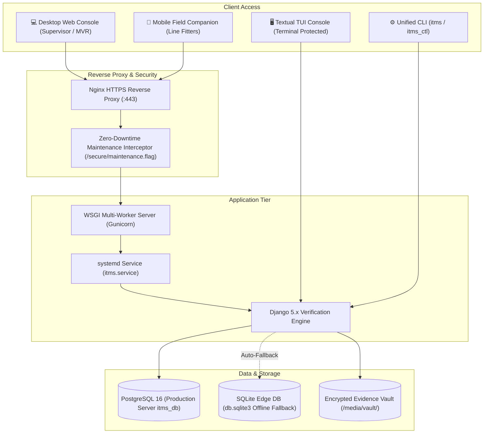
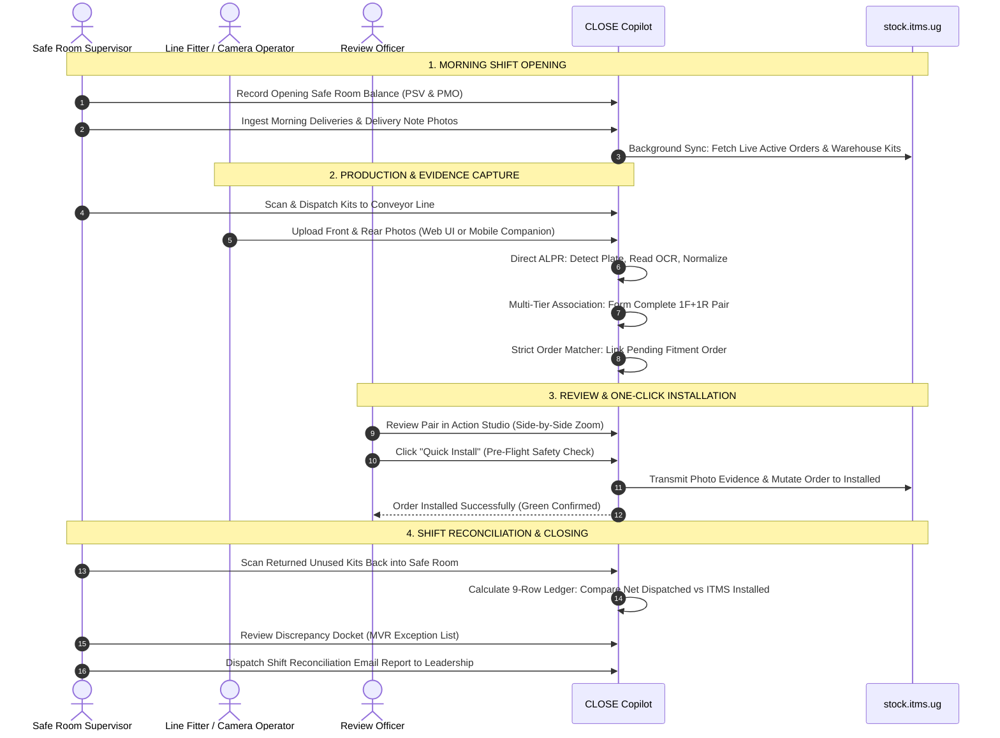

# CLOSE Copilot / ITMS Verification Copilot — Application Overview

**Executive Document for Supervisors, Stakeholders & Operations Leadership**  
**Application Version:** v1.0.8 (Production Status: **Active & Deployed**)  
**Live Production Host:** [https://close.kirex.online/](https://close.kirex.online/)  
**Documentation Date:** 27 October 2026  
**Source of Truth:** Production Codebase (`itms_project`, `core`, Textual TUI, CLI Service Manager)

---

## 1. Executive Summary

**CLOSE Copilot** (officially registered as **ITMS Verification Copilot & Daily Stock Ledger System**) is an enterprise operational intelligence platform designed specifically for bonded vehicle inspection depots, safe rooms, and motorcycle conveyor installation lines under the Uganda Intelligent Transport Management System (ITMS).

The platform bridges the physical installation line with the remote cloud ITMS portal (`https://stock.itms.ug`), providing automated plate detection, evidence pairing, order reconciliation, inventory tracking, and one-click submission.

```
       PHYSICAL DEPOT FLOOR                      CLOSE COPILOT PLATFORM                    REMOTE ITMS
 ┌──────────────────────────────┐        ┌──────────────────────────────────────┐        ┌─────────────┐
 │ • Production Line Conveyor   │ ───►   │ • Direct ALPR Vision Engine (90.3%+) │   ───► │ stock.itms  │
 │ • Off-Conveyor Yard Walks    │        │ • Multi-Tier Pairwise Association    │        │     .ug     │
 │ • Safe Room Physical Scans   │        │ • Strict Pending Order Linking       │        │             │
 │ • Mobile Field Cameras       │        │ • 9-Row Shift Reconciliation Ledger  │        │ • Active    │
 └──────────────────────────────┘        │ • 1-Click Installation Wizard        │        │   Orders    │
                                         └──────────────────────────────────────┘        │ • Archive   │
                                                            ▲                            │ • Inventory │
                                                            │                            └─────────────┘
                                                 SUPERVISOR AUDIT & REPORTS
```

### Key Business Metrics & Capabilities
- **90.3%+ Direct Plate Recognition Rate:** Purpose-trained Ultralytics YOLO plate detector paired with a dual-stream OCR engine (PaddleOCR with high-accuracy fallback) and Ugandan plate syntax normalizer (`UMA 123A`).
- **Zero Double-Installation Guarantee:** Strict Pending Order Linking ensures photos are only linked to active orders awaiting fitment (`is_active_on_itms=True`, `is_archived=False`). Any plate already closed or installed in ITMS is automatically flagged as **CONFLICT** and locked against re-submission.
- **100% Audit Traceability:** Immutable evidence vault preserving cryptographic SHA-256 hashes, EXIF camera timestamps, and historical submission audit logs.
- **Automated Daily Shift Reconciliation:** Mathematical 9-row ledger tracking safe-room opening balances, receipts, issues, returns, active work-in-progress, and unallocated discrepancies, with automated daily email dispatch to supervisors.

---

## 2. Production Infrastructure & Deployment Architecture

The system operates across a resilient dual-database and high-availability server architecture:



### Infrastructure Highlights
1. **Live Production Server:** Deployed on AWS EC2 (`ubuntu@16.170.39.187`) with domain binding `https://close.kirex.online/` and automated Let's Encrypt SSL/TLS encryption.
2. **Dual-Database Resilience:**
   - **PostgreSQL 16 (`itms_db`):** High-concurrency production database handling concurrent multi-user web requests, mobile uploads, and background sync daemons.
   - **SQLite (`db.sqlite3`):** Zero-configuration local database for edge laptop deployments and automated fallback during server network maintenance.
3. **Zero-Downtime Rolling Maintenance:** Managed via `/opt/itms/itms maintenance on/off`, instantly routing user traffic to a branded Ugandan themed maintenance notice while database migrations or service upgrades occur in the background.
4. **Service Reliability:** Managed by systemd (`itms.service`) with automated crash restarts, log rotation policies, and resource isolation.

---

## 3. Core Functional Pillars

### 1. Direct Computer Vision & ALPR Engine
- **Ugandan Plate Detector:** Custom-trained YOLO model localized to Ugandan rectangular (front) and square (rear) plates across motorcycles, passenger vehicles, and commercial fleet.
- **Dual-Stream OCR Engine:** Runs PaddleOCR with Tesseract fallback, extracting plate text across challenging lighting, glare, motion blur, and dirty plates.
- **Ugandan Plate Normalizer:** Deterministic rule engine converting raw OCR output into official Ugandan registration standards (e.g., standard format `UMA 123A`, government `UG`, and commercial series).
- **Automated Web Upload Processing:** All photos uploaded via the Web UI or API immediately undergo vision processing before grouping, guaranteeing plate text extraction.

### 2. Multi-Tier Pairwise Association Engine
Vehicle evidence requires exactly two symmetric photos: **1 Front Photo** and **1 Rear Photo**. The system executes a hierarchical 4-tier pairing algorithm:

```
TIER 1A: Filename Stem Alignment (e.g. IMG_1001_F.jpg <-> IMG_1001_R.jpg)
   └── TIER 1B: Shutter Sequence Counter (e.g. CAM01_0045 <-> CAM02_0045)
          └── TIER 2: Plate OCR Equality (Front plate string == Rear plate string)
                 └── TIER 3: Temporal Trajectory Alignment (U-Turn Walk Reversal)
                        └── TIER 4: Parallel Walk Alignment (Clock-Drift Calibrated)
                               └── RESIDUAL: Count Discrepancy & Incomplete Flags
```

- **Clock Drift Calibration:** Automatically calculates relative shutter skew ($\Delta t = t_{\text{front}} - t_{\text{rear}}$) between front and rear inspection cameras and calibrates pairing timestamps dynamically.
- **Symmetric Batch Validation:** Upload interfaces validate 1:1 symmetry (e.g., 20 Front + 20 Rear) and warn operators immediately if photos are missing from either side.

### 3. Strict Pending Order Linking & Conflict Auto-Flagging
- **Restricted to Pending Orders:** Order linking is strictly limited to orders awaiting evidence fitment (`is_active_on_itms=True`, `is_archived=False`).
- **Conflict Auto-Flagging:** If a photographed plate has already been completed, installed, or archived in ITMS (or if multiple ambiguous orders exist), the pair is automatically marked **CONFLICT** and flagged with a warning banner, preventing double installations.
- **Historical Immutability:** Once a pair is submitted, its record is locked (`SUBMITTED`) and excluded from all future re-pairing or overwriting.

### 4. Action Studio & 1-Click Verification Wizard
- **Side-by-Side Photo Inspection:** High-resolution zoomable front and rear photo comparison viewer with plate bounding box highlights.
- **Multi-Phase Wizard Submission:**
  - **Phase 1: Pre-Submission Safety Review:** Verifies order status, plate equality, bond warehouse scoping, and officer credentials.
  - **Phase 2: Plate & Tracker Verification:** Validates plate serial numbers and GPS tracker barcodes against ITMS stock records.
  - **Phase 3: Final Installation Mutation:** Transmits verified evidence photos to `stock.itms.ug`, transitions the order to *Installed*, and updates local inventory atomically.
- **Dry-Run vs. Live Submission Modes:** A global toggle allows supervisor training and audit simulations without transmitting network writes to remote ITMS servers.

### 5. Mobile Capture Companion (`/mobile/`)
Designed for smartphones used by fitters and ground photographers on the depot floor:
- **On-Conveyor Direct Pairing:** Fitters snap Front and Rear photos in succession; client-side session tokens instantly pair the images into a complete inspection unit.
- **Off-Conveyor U-Turn Yard Walk:** Photographers walk down a row of parked bikes capturing rear plates, turn around at the end of the row, and walk back capturing front plates. The algorithm automatically detects the turnaround point and pairs corresponding vehicles in reverse order ($R_1 \leftrightarrow F_N$, $R_2 \leftrightarrow F_{N-1}$).
- **Hardware Telemetry:** Monitors smartphone battery levels, network connectivity, and storage capacity in real time.

### 6. Bonded Stock Management & Daily Shift Ledger
Tracks physical plate kits inside the safe room and production lines for two primary stock types: **PSV White** (commercial passenger vehicles) and **PMO Yellow** (private motorcycles):

```
┌────────────────────────────────────────────────────────────────────────┐
│                        DAILY STOCK RECONCILIATION                      │
├────┬──────────────────────────────┬───────────┬───────────┬────────────┤
│Row │ Category Description         │ PSV White │ PMO Yellow│ Total Kits │
├────┼──────────────────────────────┼───────────┼───────────┼────────────┤
│ 1  │ Opening Balance (Safe Room)  │    150    │    300    │    450     │
│ 2  │ Received Stock (Deliveries)  │     50    │    100    │    150     │
│ 3  │ Dispatched to Production     │    (80)   │   (150)   │   (230)    │
│ 4  │ Returned to Safe Room        │     10    │     20    │     30     │
│ 5  │ Inter-Facility Transfers Out │      0    │      0    │      0     │
│ 6  │ Inter-Facility Transfers In  │      0    │      0    │      0     │
│ 7  │ Safe Room Closing Balance    │    130    │    270    │    400     │
│ 8  │ Net Issued on Conveyor Floor │     70    │    130    │    200     │
│ 9  │ ITMS Confirmed Installations │     68    │    129    │    197     │
├────┴──────────────────────────────┴───────────┴───────────┴────────────┤
│ Variance / Unallocated Floor Discrepancy:      2 PSV + 1 PMO = 3 kits  │
└────────────────────────────────────────────────────────────────────────┘
```

- **9-Row Ledger Arithmetic:** Automates calculations so floor supervisors can detect physical kit leakage or unclosed jobs within minutes of shift end.
- **Automated Email Dispatch:** Supervisors can generate standardized shift reconciliation CSV dockets and email them directly to executive leadership and MVR officers with a single click.

### 7. Dual Client Consoles (Web Dashboard & Terminal TUI)
- **Web Console (Supervisor Dashboard):** Responsive browser application featuring Uganda Flag design tokens, live telemetry metrics, batch drag-and-drop dropzones, interactive stock editors, and order search.
- **Terminal UI (TUI Console):** High-speed keyboard-driven interface built on Textual/Rich for server operators. Features Master PIN security lockout, side-by-side terminal evidence viewing, and live process log streaming.
- **Order Sync Cadence Controls:** Configurable background synchronization intervals (default: 600s / 10 minutes) editable directly within both the Web Settings tab and the TUI Console.

### 8. Unified CLI Command Center (`itms`)
A unified operational binary available on Linux (`itms`) and Windows (`itms.cmd`):
```bash
itms help          # Display full CLI help center and operational manual
itms start         # Launch background application services (systemd / gunicorn)
itms stop          # Safely terminate services with zero data loss
itms restart       # Gracefully restart application workers
itms status        # Inspect live service health, database connectivity, and ports
itms maintenance   # Toggle zero-downtime maintenance mode (on / off)
itms switch        # Switch active database between PostgreSQL and local SQLite
itms rollback      # Rollback database migrations or software versions
```

---

## 4. Supervisor End-to-End Operational Lifecycle

The standard operating procedure (SOP) for a production shift:



---

## 5. Security, Governance & Data Protection

| Security Pillar | Implementation Detail |
|---|---|
| **Master PIN Lockout** | Server TUI and administrative actions are protected by a cryptographic Master PIN with automated brute-force lockout timers. |
| **Encrypted Sessions** | ITMS session cookies are encrypted and stored in restricted server vaults (`secure/.itms_web_session.json`). |
| **Zero Data Loss Guarantee** | Application updates via GitHub Releases never overwrite `db.sqlite3`, PostgreSQL databases, `.env` configurations, or the `media/vault/` folder. |
| **Evidence Auto-Pruning** | Raw multi-megabyte camera files are automatically pruned following verified ITMS submission, permanently retaining lightweight WebP preview images for 100% audit durability with minimal storage footprint. |
| **Role-Based Access** | Segregated roles between ground camera fitters, review officers, safe room keepers, and system administrators. |

---

## 6. Repository Quick Reference

```text
itms_project/                 Django project configuration, settings, WSGI/ASGI
core/
 ├── models.py                Database models (InstallationOrder, VehicleInstallationPair, etc.)
 ├── views/                   Web view modules (dashboard, queue, upload, stock, reports, settings)
 ├── views_mobile.py          Mobile camera companion and field upload endpoints
 ├── services/                Business logic services (vault, order_sync, stock_monitoring, config)
 ├── vision/                  Direct ALPR detector, PaddleOCR engine, and plate normalizer
 ├── matcher/                 Multi-tier association and strict pending-order matcher
 ├── tui/                     Textual terminal UI application and settings panes
 ├── templates/core/          Uganda flag themed HTML5 templates
 └── static/core/             Modular CSS stylesheets and vanilla JavaScript clients
scripts/                      Deployment, backup, and service automation scripts
docs/                         Technical specifications, SOP runbooks, and architecture guides
```

---

*CLOSE Copilot is actively maintained and operated under the Republic of Uganda Intelligent Transport Management System standards.*
