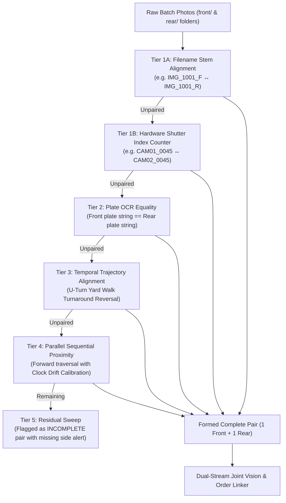
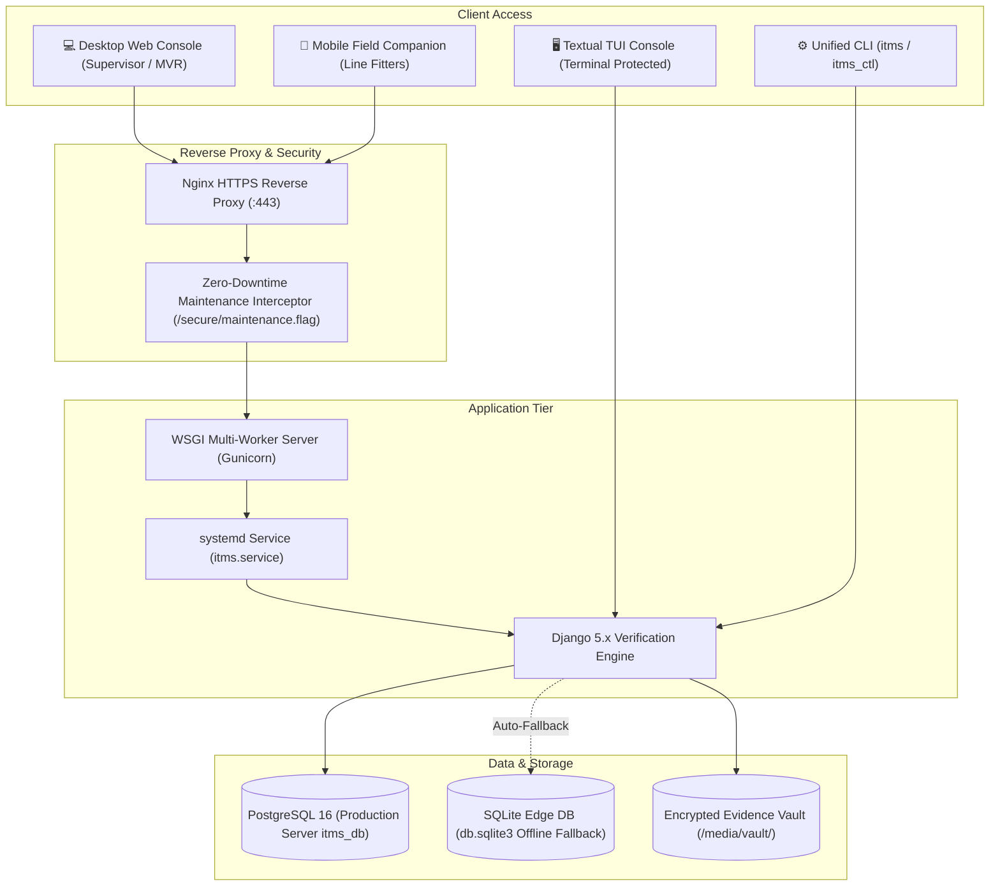
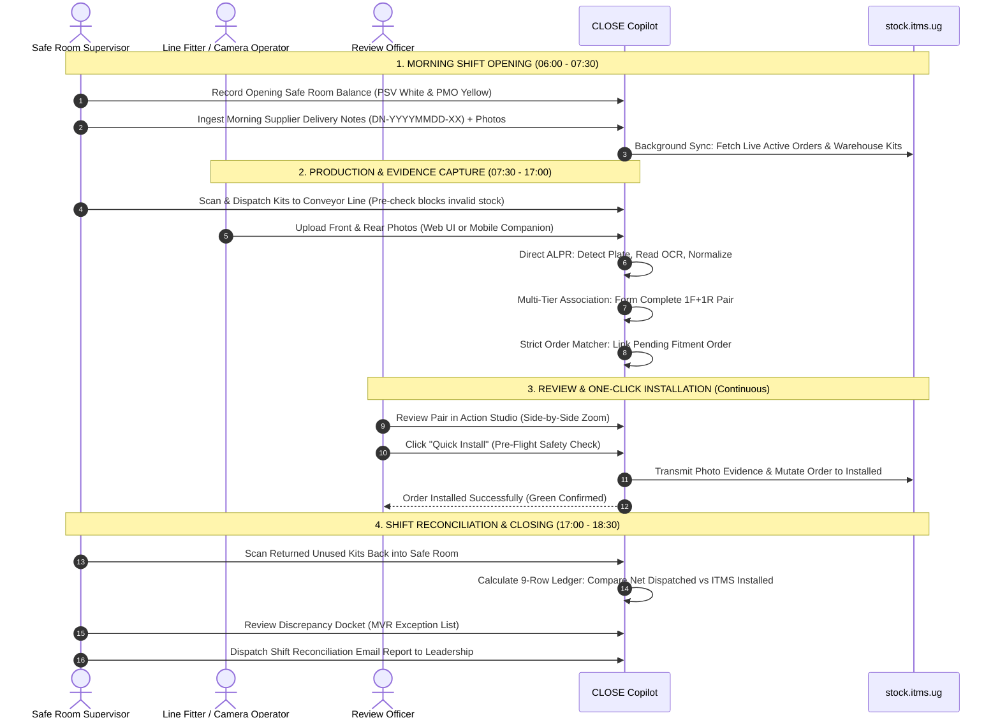
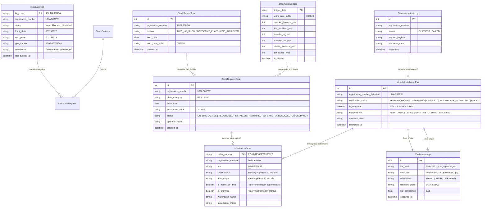

# CLOSE Copilot / ITMS Verification Copilot — Master Application & Documentation Overview

**The Definitive Operational, Architectural & Technical Reference Guide for Supervisors, Stakeholders, and Engineering Leadership**  
**Application Version:** v1.1.0 (Production Status: **Active & Deployed**)  
**Live Production Host:** [https://close.kirex.online/](https://close.kirex.online/)  
**Documentation Date:** 28 October 2026  
**Source of Truth:** Production Codebase (`itms_project`, `core`, Textual TUI, CLI Service Manager, and the `docs/` repository library)

---

## 1. Executive Summary

**CLOSE Copilot** (officially registered as **ITMS Verification Copilot & Daily Stock Ledger System**) is an enterprise-grade operational intelligence and verification platform developed for high-security motor vehicle inspection depots, safe rooms, and motorcycle conveyor assembly lines under the Republic of Uganda Intelligent Transport Management System (ITMS).

The platform bridges the physical installation line with the remote cloud ITMS portal (`https://stock.itms.ug`), providing automated plate detection, evidence pairing, order reconciliation, inventory tracking, and one-click submission.

```
       PHYSICAL DEPOT FLOOR                      CLOSE COPILOT PLATFORM                    REMOTE ITMS
 ┌──────────────────────────────┐        ┌──────────────────────────────────────┐        ┌─────────────┐
 │ • Production Line Conveyor   │ ───►   │ • Direct ALPR Vision Engine (90.3%+) │   ───► │ stock.itms  │
 │ • Off-Conveyor Yard Walks    │        │ • Multi-Tier Pairwise Association    │        │     .ug     │
 │ • Safe Room Physical Scans   │        │ • Strict Pending Order Linking       │        │             │
 │ • Mobile Field Cameras       │        │ • 9-Row Shift Reconciliation Ledger  │        │ • Active    │
 └──────────────────────────────┘        │ • 1-Click Installation Wizard        │        │   Orders    │
                                         └──────────────────────────────────────┘        │ • Archive   │
                                                            ▲                            │ • Inventory │
                                                            │                            └─────────────┘
                                                 SUPERVISOR AUDIT & REPORTS
```

### Core Business Value & Key Performance Indicators
- **90.3%+ Direct Plate Recognition Rate:** Purpose-trained Ultralytics YOLO plate detector paired with a dual-stream OCR engine (PaddleOCR with high-accuracy fallback) and Ugandan plate syntax normalizer (`UMA 123A`).
- **Zero Double-Installation Guarantee:** Strict Pending Order Linking ensures photos are only linked to active orders awaiting fitment (`is_active_on_itms=True`, `is_archived=False`). Any plate already closed or installed in ITMS is automatically flagged as **CONFLICT** and locked against re-submission.
- **100% Audit Traceability:** Immutable evidence vault preserving cryptographic SHA-256 hashes, EXIF camera timestamps, and historical submission audit logs.
- **Automated Daily Shift Reconciliation:** Mathematical 9-row ledger tracking safe-room opening balances, receipts, issues, returns, active work-in-progress, and unallocated discrepancies, with automated daily email dispatch to supervisors.

---

## 2. Operational Challenges & The Problems This App Solves

Vehicle fitment facilities (such as the AGM Bonded Warehouse, Naguru Fitment Center, and regional depots) process hundreds of motorcycles and commercial vehicles every shift. Prior to CLOSE Copilot, facilities struggled with six critical operational bottlenecks documented across `docs/propsal.md`, `docs/AGM_BOND_OPERATIONAL_ROADMAP.md`, and `docs/SYSTEM_ARCHITECTURE_AND_DATAFLOW.md`:

```
┌──────────────────────────────────────────────────────────────────────────────────────────────────┐
│                                   SIX CORE OPERATIONAL BOTTLENECKS                               │
├────────────────────────────────┬─────────────────────────────────────────────────────────────────┤
│ 1. High Operator Latency       │ Fitters and review operators spent up to 8 minutes per vehicle  │
│    & Web Form Fatigue          │ manually searching orders, typing plate strings, rotating photos│
│                                │ on flash drives, and uploading files one by one.                │
├────────────────────────────────┼─────────────────────────────────────────────────────────────────┤
│ 2. Human Misidentification &   │ Under pressure, operators misread confusing alphanumeric pairs  │
│    Transcription Errors        │ (`8` vs `B`, `0` vs `O`, `Z` vs `2`, `1` vs `I`), swapped front  │
│                                │ and rear photos, or accidentally attached photos to wrong cars. │
├────────────────────────────────┼─────────────────────────────────────────────────────────────────┤
│ 3. Optical Asymmetry &         │ Rear plates are clean stamped reflective metal (high contrast), │
│    Muddy Front Mudguards       │ but front motorcycle plates are stenciled or painted on curved  │
│                                │ mudguards, heavily degraded by road dust, mud spatter, and glare│
├────────────────────────────────┼─────────────────────────────────────────────────────────────────┤
│ 4. Unallocated Floor Leakage   │ Plates were physically dispatched from safe rooms and bolted    │
│    & MVR Skipped Orders        │ onto bikes, but the MVR officer skipped creating the digital    │
│                                │ order in ITMS—leaving vehicles unrecorded and untracked.        │
├────────────────────────────────┼─────────────────────────────────────────────────────────────────┤
│ 5. Safe Room Liability &       │ Safe-room keepers faced severe personal and criminal liability  │
│    Discrepancy Blindspots      │ for missing digital plates, with no real-time audit reconciling │
│                                │ supplier delivery notes, floor issues, and ITMS records.        │
├────────────────────────────────┼─────────────────────────────────────────────────────────────────┤
│ 6. Fragile Factory Wi-Fi &     │ Weak yard network coverage caused uploads to fail; taking SD    │
│    Database Lockups            │ cards back and forth created delays; and SQLite database locks  │
│                                │ crashed concurrent background vision tasks.                     │
└────────────────────────────────┴─────────────────────────────────────────────────────────────────┘
```

---

## 3. How CLOSE Copilot Solves These Problems

CLOSE Copilot implements a multi-layered, fault-tolerant engineering architecture to solve each bottleneck systematically:

### 3.1 Direct Computer Vision & ALPR Engine (`core/vision/`)
*(Detailed in `docs/PAIR_FIRST_AND_DUAL_STREAM_VISION_ARCHITECTURE.md`, `docs/training.md`, `docs/RELEASE_NOTES_v1.1.0.md`)*
- **Ugandan Plate Detector:** Custom-trained Ultralytics YOLO model localized to Ugandan rectangular (front) and square (rear) plates across motorcycles, passenger vehicles, and commercial fleet.
- **Direct Character Recognizer (ALPR):** Direct character-level detection and recognition on high-resolution plate crops (`core/vision/character_recognizer.py`), achieving 90.3%+ first-pass accuracy without generic dictionary dependencies.
- **Dual-Engine OCR Fallback:** Retains PaddleOCR and Tesseract as fallback engines when character recognition confidence is below configurable thresholds.
- **Ugandan Plate Normalizer:** Deterministic rule engine converting raw OCR output into official Ugandan registration standards (e.g., standard motorcycle format `UMA 123A`, passenger vehicles `UBD 123A`, government `UG`, and commercial series).
- **Automated Web Upload Processing:** All photos uploaded via the Web UI or API immediately undergo vision processing before grouping, guaranteeing plate text extraction.

### 3.2 Pair-First Multi-Tier Association Engine (`core/matcher/association.py`)
*(Detailed in `docs/PAIR_FIRST_AND_DUAL_STREAM_VISION_ARCHITECTURE.md` and `docs/PAIRWISE_ASSOCIATION_TIME_AND_NAMING.md`)*
Rather than relying solely on fragile isolated OCR text, the system establishes a physical pair candidate first using spatial-temporal camera signals, and then evaluates joint vision:



- **U-Turn Yard Walk Trajectory Geometry:** When technicians photograph long rows of parked bikes (shooting rears outbound, turning around, and shooting fronts inbound), the system calculates:
  $$\Delta t_{	ext{turnaround}} = \min(|t_{F_1} - t_{R_N}|, |t_{R_1} - t_{F_M}|)$$
  $$\Delta t_{	ext{parallel}} = |t_{F_1} - t_{R_1}|$$
  If $\Delta t_{	ext{turnaround}} \le \Delta t_{	ext{parallel}}$, the system automatically detects the turnaround point and pairs vehicles in reverse order ($R_i \leftrightarrow F_{N-i+1}$), pairing vehicles with 100% accuracy even if the front plate is completely illegible.
- **Clock Drift Calibration:** Automatically calculates relative shutter skew ($\Delta t = t_{	ext{front}} - t_{	ext{rear}}$) across inspection cameras and calibrates pairing timestamps dynamically.
- **Symmetric Batch Validation:** Upload interfaces validate 1:1 symmetry (e.g., 20 Front + 20 Rear) and warn operators immediately if photos are missing from either side.

### 3.3 Dual-Stream Joint Vision & Asymmetric Recovery (`core/vision/joint_pipeline.py`)
- **Asymmetric Single-Side Recovery:** Stamped rear plates yield 85–95% OCR accuracy, while muddy front mudguards often yield degraded text. When one plate is valid and the other is ambiguous, the system automatically uses the clean rear plate to rescue the pair (`ASYMMETRIC_RECOVERED`), marking it `PENDING_REVIEW` instead of `CONFLICT`.
- **Bayesian Active-Order Prior Triangulation:** The system uses locally synchronized ITMS active orders as a bounded search space (`disambiguate_plate_with_orders()`), resolving blurry OCR characters (e.g. resolving `UMA186PK` to active order `UMA480PK`).
- **Color Category Homogeneity Check:** Validates that front and rear plate colors match the expected Ugandan category (PSV Commercial = White front & White rear; PMO Private Motorcycle = Yellow front & Yellow rear). Mixed colors trigger a `COLOR_CONFLICT` flag.
- **Differential Orientation Verification:** Detects central red motorcycle taillights in HSV space (`Hue ∈ [0, 10] ∪ [170, 180]`, `Sat > 90`, `Val > 80`) to definitively classify Front vs. Rear orientation.

### 3.4 Strict Pending Order Linking & Conflict Auto-Flagging (`core/matcher/order_matcher.py`)
- **Restricted to Pending Orders:** Order linking is strictly limited to orders awaiting evidence fitment (`is_active_on_itms=True`, `is_archived=False`).
- **Conflict Auto-Flagging:** If a photographed plate has already been completed, installed, or archived in ITMS (or if multiple ambiguous orders exist), the pair is automatically marked **CONFLICT** and flagged with a warning banner, preventing double installations.
- **Historical Immutability:** Once a pair is submitted, its record is locked (`SUBMITTED`) and excluded from all future re-pairing or overwriting.

### 3.5 Dual-Track Operational Architecture (`docs/SYSTEM_ARCHITECTURE_AND_DATAFLOW.md`)
The system strictly decouples physical safe room hardware custody from factory floor digital order auditing:

```
┌────────────────────────────────────────────────────────────────────────────────────────┐
│ TRACK 1: PHYSICAL SAFE ROOM INVENTORY CONTROL (Physical Hardware)                      │
│ - Delivery Note Inbound Intakes (Supplier manifests into the bond safe room)           │
│ - Morning Shift Line Dispatches (Kits physically handed to fitters)                   │
│ - Evening Returns (Leftover uninstalled kits safely returned to safe room)             │
│ - Shift Closing Balance: Opening + Received + In - Out - Installed = Closing           │
└──────────────────────────────────────────┬─────────────────────────────────────────────┘
                                           │ Ground Truth Dispatches
                                           ▼
┌────────────────────────────────────────────────────────────────────────────────────────┐
│ TRACK 2: FACTORY FLOOR FITMENT & MVR EXCEPTION DOCKET (Digital Orders)                 │
│ - Motorcycle Assembly Line Fitting (Plates physically bolted onto bikes)               │
│ - ITMS Order Verification (MVR Officer creates order in ITMS)                          │
│ - Floor Discrepancy Detection: Dispatched − Returned − Archived − Active Orders        │
│ - Actionable MVR Exception Docket generation for 1-click clipboard allocation          │
└────────────────────────────────────────────────────────────────────────────────────────┘
```

#### Safe Room Physical Balance Equation:
$$\mathbf{Closing\ Balance} = 	ext{Opening} + 	ext{Received} + 	ext{Transfer In} - 	ext{Transfer Out} - 	ext{Installed} - 	ext{Defective}$$

#### Factory Floor Elimination Audit (MVR Discrepancy Scale):
$$\mathbf{Net\ Physically\ on\ Line} = 	ext{Dispatched Scans} - 	ext{Returned Scans}$$
$$\mathbf{Unallocated\ Floor\ Discrepancy} = \mathbf{Net\ Physically\ on\ Line} - 	ext{ITMS Archived Orders} - 	ext{ITMS Active Orders}$$

#### The "Set Aside" Pre-Dispatch Verification Workflow (`docs/SYSTEM_ARCHITECTURE_AND_DATAFLOW.md`):
When safe room keepers scan plate barcodes during morning dispatch, each barcode is checked against synchronized ITMS stock:
1. If present and not installed: Allowed for dispatch (`ON_LINE_ACTIVE`).
2. If already installed: Blocked (`ALREADY_INSTALLED`).
3. If not registered on ITMS stock: **BLOCKED (`SET_ASIDE_TRIGGERED`)**. The physical plate is set aside in the safe room, an alert is sent to the ITMS Stock Transfer Officer, and a replacement kit is issued—preventing unrecorded bikes on the road.

### 3.6 Mobile Field Companion (`/mobile/`)
*(Detailed in `docs/MOBILE_CAMERA_CONNECTION_AND_VERIFICATION.md`)*
- **Zero-Install PWA:** Runs directly on any smartphone browser on the local depot network (`http://<ip>:8000/mobile/`), utilizing HTML5 camera hardware with autofocus, sensor flash, and full optical resolution.
- **Dynamic Multi-Network Discovery:** Automatically detects and adapts across `LAPTOP_HOTSPOT` (`192.168.137.1`), `PHONE_HOTSPOT`, and `WIFI_LAN`. Compact ISO/IEC 18004 Unicode QR codes on the TUI and Web dashboards let technicians pair their phones in seconds.
- **On-Conveyor Guided Mode:** Single smart shutter button guiding technicians through Front $
ightarrow$ Rear $
ightarrow$ Auto-Lock, associating photos instantly via client-side session tokens.
- **Off-Conveyor U-Turn Yard Walk:** Enables continuous photo capture during row walks, streaming photos to the server with trajectory metadata.
- **Hardware Telemetry:** Monitors phone battery level, local storage, and round-trip network ping in real time.

### 3.7 Dual Client Consoles (Web Dashboard & Terminal TUI)
- **Web Console (Supervisor Dashboard):** Responsive browser application featuring Uganda Flag design tokens, live telemetry metrics, batch drag-and-drop dropzones, interactive stock editors, order search, and 1-click wizard submissions.
- **Terminal UI (TUI Console):** High-speed keyboard-driven interface built on Textual/Rich for server operators. Features Master PIN security lockout, side-by-side terminal evidence viewing, Command Palette (`Ctrl+P`), Fast Plate Typing (`[T]`), and live process log streaming.
- **Order Sync Cadence Controls:** Configurable background synchronization intervals (default: 600s / 10 minutes) editable directly within both the Web Settings tab and the TUI Console.

### 3.8 Unified CLI Command Center (`itms`)
A unified operational binary available on Linux (`itms`) and Windows (`itms.cmd`):
```bash
itms help          # Display full CLI help center and operational manual
itms start         # Launch background application services (systemd / gunicorn)
itms stop          # Safely terminate services with zero data loss
itms restart       # Gracefully restart application workers
itms status        # Inspect live service health, database connectivity, and ports
itms maintenance   # Toggle zero-downtime maintenance mode (on / off)
itms switch        # Switch active database between PostgreSQL and local SQLite
itms rollback      # Rollback database migrations or software versions
```

---

## 4. Production Infrastructure & Deployment Architecture



### Infrastructure & Engineering Safeguards
1. **Live Production Server:** Deployed on AWS EC2 (`ubuntu@16.170.39.187`) with domain binding `https://close.kirex.online/` and automated Let's Encrypt SSL/TLS encryption.
2. **Dual-Database Resilience:**
   - **PostgreSQL 16 (`itms_db`):** High-concurrency production database handling concurrent multi-user web requests, mobile uploads, and background sync daemons.
   - **SQLite (`db.sqlite3`):** Zero-configuration local database for edge laptop deployments and automated fallback during server network maintenance.
3. **SQLite WAL Mode & Busy Timeout:** To prevent `database is locked` errors during background vision processing, SQLite runs in Write-Ahead Logging (`PRAGMA journal_mode = WAL;`) with a 60,000ms busy timeout (`core/apps.py`), ensuring UI reads never block background writes.
4. **Zero-Downtime Rolling Maintenance:** Managed via `itms maintenance on/off`, instantly routing user traffic to a branded Ugandan themed maintenance notice while database migrations or service upgrades occur in the background.
5. **Non-Destructive Version Rollback Engine:** Operators can instantly roll back to any previous release tag (`v1.0.9`, `v1.0.8`) directly from TUI Settings or CLI (`itms rollback [tag]`), with automatic pre-update snapshot creation (`secure/.rollback_point`). Untracked database assets (`db.sqlite3`), evidence photos (`media/vault/`), and secrets (`.env`) are never overwritten.
6. **Rate Limiting & Circuit Breakers:** ITMS crawler incorporates polite pacing (0.35s sleep with jitter), exponential backoff on HTTP 429 (`Retry-After`), and a circuit breaker that trips after 3 consecutive failures to protect remote state servers.

---

## 5. Supervisor End-to-End Operational Lifecycle & Daily Shift SOP

The standard operating procedure (SOP) across a standard shift:



---

## 6. Comprehensive Documentation Index (`docs/` Library Map)

The `docs/` directory contains an exhaustive repository of technical specifications, operational runbooks, and enterprise architecture standards:

### 6.1 Core Operational & System Documentation

| Document | Primary Focus & Summary |
|---|---|
| [`docs/APP_OVERVIEW.md`](file:///F:/website%20backup/projects/itms_verification/itms_verification/docs/APP_OVERVIEW.md) | **Master Document (This File):** Comprehensive overview of system purpose, business value, production infrastructure, operational workflows, and data models. |
| [`docs/propsal.md`](file:///F:/website%20backup/projects/itms_verification/itms_verification/docs/propsal.md) | **Original Architecture Proposal:** The foundational document outlining the 8-step pipeline, human-in-the-loop TUI verification, and bounded search space concepts. |
| [`docs/SYSTEM_ARCHITECTURE_AND_DATAFLOW.md`](file:///F:/website%20backup/projects/itms_verification/itms_verification/docs/SYSTEM_ARCHITECTURE_AND_DATAFLOW.md) | **System Architecture & Dataflow:** Complete technical breakdown of the dual-track lifecycle, crawler pacing, bulk persistence, and mathematical reconciliation models. |
| [`docs/AGM_BOND_OPERATIONAL_ROADMAP.md`](file:///F:/website%20backup/projects/itms_verification/itms_verification/docs/AGM_BOND_OPERATIONAL_ROADMAP.md) | **AGM Bonded Warehouse Runbook:** Operational procedures for delivery note intakes, safe room storage, morning dispatches, evening returns, and MVR handoff dockets. |
| [`docs/PAIR_FIRST_AND_DUAL_STREAM_VISION_ARCHITECTURE.md`](file:///F:/website%20backup/projects/itms_verification/itms_verification/docs/PAIR_FIRST_AND_DUAL_STREAM_VISION_ARCHITECTURE.md) | **Joint Vision Specification:** The pair-first paradigm, Bayesian order prior triangulation, taillight detection, and asymmetric single-side recovery algorithms. |
| [`docs/PAIRWISE_ASSOCIATION_TIME_AND_NAMING.md`](file:///F:/website%20backup/projects/itms_verification/itms_verification/docs/PAIRWISE_ASSOCIATION_TIME_AND_NAMING.md) | **Pairwise Matching Heuristics:** Mathematical formulation of U-Turn trajectory walk detection, camera shutter sequencing, and EXIF timestamp alignment. |
| [`docs/MOBILE_CAMERA_CONNECTION_AND_VERIFICATION.md`](file:///F:/website%20backup/projects/itms_verification/itms_verification/docs/MOBILE_CAMERA_CONNECTION_AND_VERIFICATION.md) | **Mobile Companion Guide:** Zero-install PWA design, dynamic network classification (`LAPTOP_HOTSPOT`, `WIFI_LAN`), compact QR codes, and field ergonomics. |
| [`docs/FILE_FOLDER_LIFECYCLE_AND_MAINTENANCE.md`](file:///F:/website%20backup/projects/itms_verification/itms_verification/docs/FILE_FOLDER_LIFECYCLE_AND_MAINTENANCE.md) | **Storage & Vault Lifecycle:** Vault directory layout (`media/vault/YYYY-MM-DD/`), SHA-256 deduplication, post-submission auto-pruning, and database retention policies. |
| [`docs/DISTRIBUTION_AND_INSTALLATION.md`](file:///F:/website%20backup/projects/itms_verification/itms_verification/docs/DISTRIBUTION_AND_INSTALLATION.md) | **Deployment & Installation:** Standalone workstation vs. server setup, GitHub Releases updater, backup guarantees, and WSGI/systemd configuration. |
| [`docs/training.md`](file:///F:/website%20backup/projects/itms_verification/itms_verification/docs/training.md) & [`docs/traning.md`](file:///F:/website%20backup/projects/itms_verification/itms_verification/docs/traning.md) | **YOLO Training Runbook:** Dataset preparation, bounding box annotation, synthetic augmentation, and model evaluation for Ugandan vehicle plates. |
| [`docs/ROADMAP.md`](file:///F:/website%20backup/projects/itms_verification/itms_verification/docs/ROADMAP.md) | **Product Roadmap:** Tracking completed milestones and future enhancements across ALPR, stock management, and integration. |
| [`docs/Report.md`](file:///F:/website%20backup/projects/itms_verification/itms_verification/docs/Report.md) & [`docs/auth-future.md`](file:///F:/website%20backup/projects/itms_verification/itms_verification/docs/auth-future.md) | **Security & Audit Reviews:** Static security assessments, cryptographic session storage, Master PIN protection, and future role-based authorization designs. |
| [`docs/BACKEND REQUEST.MD`](file:///F:/website%20backup/projects/itms_verification/itms_verification/docs/BACKEND%20REQUEST.MD) | **Backend Engineering Changelog:** Historical log of backend API implementations, bug fixes, database migrations, and unit test results. |
| [`docs/FRONTEND REQUEST.MD`](file:///F:/website%20backup/projects/itms_verification/itms_verification/docs/FRONTEND%20REQUEST.MD) | **Frontend Specification & UI Log:** Detailed design specifications, theme tokens, modal workflows, and responsive layout adjustments. |
| [`docs/FRONTEND_COLLABORATION_AND_GIT_GUIDE.md`](file:///F:/website%20backup/projects/itms_verification/itms_verification/docs/FRONTEND_COLLABORATION_AND_GIT_GUIDE.md) | **Git & Collaboration Rules:** Team boundaries, safe commit practices, branch synchronization (`main`, `release/linux`, `release/windows`), and review rules. |

### 6.2 Release Changelog Index

| Release Document | Milestone Summary |
|---|---|
| [`docs/RELEASE_NOTES_v1.0.6.md`](file:///F:/website%20backup/projects/itms_verification/itms_verification/docs/RELEASE_NOTES_v1.0.6.md) | Dual-stream joint vision, SQLite WAL concurrency, closest photo picker modal, and basic batch management. |
| [`docs/RELEASE_NOTES_v1.0.7.md`](file:///F:/website%20backup/projects/itms_verification/itms_verification/docs/RELEASE_NOTES_v1.0.7.md) | Mobile companion PWA, QR network discovery, U-Turn trajectory walk detection, and delivery note intake. |
| [`docs/RELEASE_NOTES_v1.0.8.md`](file:///F:/website%20backup/projects/itms_verification/itms_verification/docs/RELEASE_NOTES_v1.0.8.md) | 9-row daily stock reconciliation ledger, Spiked Undispatched Kits alert, CSV streaming exports, and supervisor email dispatch. |
| [`docs/RELEASE_NOTES_v1.0.9.md`](file:///F:/website%20backup/projects/itms_verification/itms_verification/docs/RELEASE_NOTES_v1.0.9.md) | PostgreSQL production support, AWS EC2 zero-downtime maintenance deployment, and database auto-fallback. |
| [`docs/RELEASE_NOTES_v1.1.0.md`](file:///F:/website%20backup/projects/itms_verification/itms_verification/docs/RELEASE_NOTES_v1.1.0.md) | Direct ALPR character recognition (90.3%+), non-destructive TUI/CLI rollback engine, and hardened service scripts. |

### 6.3 Enterprise Practices Library (`docs/enterprise-practices/`)

The repository formalizes 25 comprehensive enterprise standards across 6 operational categories:

```text
docs/enterprise-practices/
├── 01-api-design/
│   ├── 01-api-versioning-strategy.md            (URI /api/v1/ versioning and deprecation schedules)
│   ├── 03-api-documentation-openapi-standards.md (OpenAPI 3.1 & Swagger/Redoc generation)
│   ├── 10-api-idempotency-keys.md               (Idempotency-Key headers for mutation replay safety)
│   ├── 13-request-correlation-distributed-tracing.md (X-Trace-ID request propagation)
│   ├── 14-input-schema-validation-pydantic.md   (Strict runtime request payload validation)
│   ├── 15-pagination-strategy.md                (Cursor-based and keyset pagination for high volumes)
│   └── 16-api-response-envelope-standard.md     (Uniform JSON response envelope: data, error, meta)
├── 02-rate-limiting/
│   └── 02-rate-limiting-strategy.md             (Token bucket and sliding window rate limits)
├── 03-data-management/
│   ├── 04-data-retention-archival-policies.md   (Legal data retention and auto-pruning rules)
│   ├── 05-backup-disaster-recovery.md           (Automated database & vault snapshot policies)
│   ├── 17-soft-delete-with-recovery.md          (is_deleted soft-delete patterns with 30-day purge)
│   ├── 18-database-index-monitoring.md          (B-tree index optimization and slow query analysis)
│   ├── 21-data-export-import.md                 (High-performance CSV/JSON streaming with UTF-8 BOM)
│   └── 25-disaster-recovery-plan-rto-rpo.md     (RTO < 15m, RPO < 1h disaster recovery runbooks)
├── 04-observability/
│   ├── 07-observability-stack.md                (Structured JSON logging, Prometheus metrics, alerts)
│   └── 20-load-testing-performance-budgets.md   (Locust performance benchmarks and latency budgets)
├── 05-deployment-operations/
│   ├── 08-ci-cd-pipeline.md                     (Automated test matrix, linting, and deploy workflows)
│   ├── 09-database-migrations-strategy.md       (Zero-downtime backward-compatible schema migrations)
│   ├── 11-webhook-event-driven-architecture.md  (Asynchronous HMAC-signed webhook delivery)
│   └── 23-feature-flag-analytics.md             (Dynamic operational toggles without redeployment)
└── 06-compliance-security/
    ├── 06-compliance-audit-standards.md         (Immutable audit logs for all security actions)
    ├── 19-secrets-rotation-process.md           (Credential and session secret rotation protocols)
    ├── 22-multi-tenancy-isolation.md            (Facility and bond scoping isolation rules)
    └── 24-change-management-approval-workflows.md (Operational change management and peer reviews)
```

---

## 7. Data Concepts & Entity Relationship Architecture



---

## 8. Security, Governance & Zero-Data-Loss Guarantees

| Security & Governance Pillar | Operational Implementation |
|---|---|
| **Master PIN Lockout** | Server TUI and administrative engineering controls are protected by a cryptographic Master PIN with automated brute-force lockout timers. |
| **Encrypted Sessions** | ITMS session cookies are encrypted and stored in restricted server vaults (`secure/.itms_web_session.json`). |
| **Zero Data Loss Guarantee** | Application upgrades and rollback operations via GitHub Releases never overwrite `db.sqlite3`, PostgreSQL databases, `.env` configurations, or the `media/vault/` folder. |
| **Evidence Auto-Pruning** | Raw multi-megabyte camera files are automatically pruned following verified ITMS submission, permanently retaining lightweight WebP preview images for 100% audit durability with minimal storage footprint. |
| **Audit Immutability** | `SubmissionAuditLog` records every remote mutation, response payload, error code, and operator attribution in an append-only table. |
| **Role-Based Access** | Segregated operational roles between ground camera fitters, review officers, safe room keepers, and system administrators. |

---

## 9. Repository Structure Quick Reference

```text
itms_project/                 Django project configuration, settings, WSGI/ASGI
core/
 ├── models.py                Database models (InstallationOrder, VehicleInstallationPair, etc.)
 ├── views/                   Web view modules (dashboard, queue, upload, stock, reports, settings)
 ├── views_mobile.py          Mobile camera companion and field upload endpoints
 ├── services/                Business logic services (vault, order_sync, stock_monitoring, config)
 ├── vision/                  Direct ALPR detector, PaddleOCR engine, and plate normalizer
 ├── matcher/                 Multi-tier association and strict pending-order matcher
 ├── tui/                     Textual terminal UI application and settings panes
 ├── templates/core/          Uganda flag themed HTML5 templates
 └── static/core/             Modular CSS stylesheets and vanilla JavaScript clients
scripts/                      Deployment, backup, and service automation scripts (itms, itms.cmd)
docs/                         Comprehensive technical specifications, SOP runbooks, and enterprise standards
 └── enterprise-practices/    25 formalized enterprise architecture standards (API, security, DR)
```

---

*CLOSE Copilot is actively maintained and operated under the Republic of Uganda Intelligent Transport Management System standards.*
