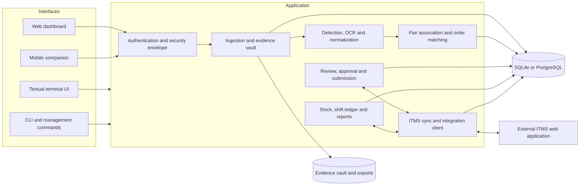

# CLOSE Copilot / ITMS Verification Copilot — Application Overview

**Purpose:** Explain what the application is for, who uses it, how its main workflows and components fit together, what data it stores, and where to find deeper guidance.

**Documentation date:** 27 October 2026  
**Source of truth:** This guide summarizes the current repository (Django project, `core` app, command-line tools, desktop terminal UI, templates, and existing technical documents). Some older documents use a future tense or describe design goals. Treat a roadmap or proposal as intent until confirmed in the running code.

## 1. What this application is

CLOSE Copilot (also named **ITMS Verification Copilot** and **ITMS Verification & Daily Stock Ledger System** in parts of the repository) is an operator tool for vehicle installation operations. It combines:

1. **Photo evidence verification:** collect front/rear vehicle photos, recognize plate text, associate photos with a vehicle and an installation order, let an operator review the result, and submit approved evidence to the external ITMS web application.
2. **Bonded stock and shift reconciliation:** track plate kits received into a safe room, issued to a production line, returned, transferred, counted, and reconciled with installation orders and completed installations in ITMS.

The application is a local operational control and verification layer around the external ITMS system. It stores working data locally and synchronizes selected order, kit, and installation information from ITMS. Its main workflows are designed to help operators find exceptions and resolve them; it does not replace the official ITMS registry.

## 2. The problems it solves

Vehicle installation operations produce high volumes of photos and physical plate-kit movements. Without a shared workflow, staff may need to sort photos manually, type registration numbers from images, search orders one by one, and compare paper or spreadsheet inventory with online records. That creates delays and makes it easy to miss a missing photo, wrong pair, unallocated kit, or unresolved order.

CLOSE Copilot addresses those problems by:

- Bringing photos from folders, web upload, or mobile phone capture into a traceable batch and evidence vault.
- Using computer vision and OCR to propose plate text and photo orientation, while preserving operator review for uncertain cases.
- Grouping related front and rear images, then matching detected plates against locally synchronized orders.
- Providing a review queue for human correction, approval, and submission.
- Recording physical stock events and reconciling them against ITMS active/archive orders.
- Keeping a local database and evidence store so operators can continue with local work and investigate history even when remote access is interrupted. Remote synchronization and live submission still require the appropriate ITMS connectivity/session.
- Offering a browser dashboard, a keyboard-oriented terminal UI, CLI workflows, and a mobile companion for different workstations and roles.

## 3. Who uses it

Typical roles reflected in the code and operational documentation include:

- **Photo capture operators / fitters:** capture front and rear evidence on the production floor, often from a phone.
- **Review operators:** correct plate reads, pair images, link the correct installation order, approve or reject records, and submit approved evidence.
- **MVR / ITMS officers:** synchronize and inspect orders, confirm installations, and resolve missing or inconsistent records.
- **Safe-room / bonded-stock keepers:** register deliveries, dispatch kits to the line, record returns/transfers/counts, and reconcile shift balances.
- **Administrators / system operators:** manage users, configuration, facilities, database and storage settings, updates, and deployment health.

The application has local Django users and separate per-operator ITMS session records. A local login does not itself prove that an operator has an active external ITMS session; some order/kit actions use a security envelope that requires an active connection and derives facility context.

## 4. Main user-facing surfaces

### Web dashboard

The Django web UI is assembled from templates in `core/templates/core/` and scripts/styles in `core/static/core/`. Its dashboard tabs cover:

- Dashboard and current activity
- ITMS account, order, archive, and kit exploration/synchronization
- Photo batches and upload
- Pair review queue
- History and audit information
- Reports and exports
- Bond stock, dispatch, delivery, return, transfer, and reconciliation
- Settings and system controls

The precise labels and visible permissions are part of the front end; backend routes are registered in `core/urls.py`.

### Mobile companion

The `/mobile/` page is a browser-based capture companion intended for phones on the workstation's network. It can capture individual images, send orientation and sequence metadata, associate on-conveyor shots using a client-side bike/session identifier, or group an off-conveyor U-turn walk into a batch. It also includes phone/device status and upload feedback. The server-side endpoints live in `core/views_mobile.py` and related device, quality, network, and vault services.

### Terminal UI (TUI)

The Textual application in `core/tui/` provides a keyboard-driven workstation interface. Its panes cover dashboard, ITMS, batches, review, audit, reports, settings, and stock operations. It can launch pipeline actions and desktop file dialogs and provides native evidence viewing. See the README for the current key bindings and `python manage.py run_tui` entry point.

### CLI and management commands

The Django management commands under `core/management/commands/` support ingestion, vision processing, association, ITMS synchronization/submission, stock synchronization, reconciliation, diagnostics, cleanup, and web/TUI startup. The root `itms`, `itms.cmd`, `itms.ps1`, and installer/launcher scripts provide packaged entry points. Consult `README.md` and `DISTRIBUTION_AND_INSTALLATION.md` for invocation details because command-line options can evolve.

## 5. Core workflows

### A. Photo evidence to verified submission

1. **Capture or ingest:** A user uploads files in the web UI/API, uses mobile capture, selects files in the TUI, or runs the `ingest_photos` command. Ingestion creates an `IngestionBatch` and one `EvidenceImage` per accepted image, storing metadata and the file in the evidence vault.
2. **Prepare the evidence:** The vault service validates and normalizes the file, computes content hashes for duplicate detection, and records orientation/source metadata. Batch counts and operator/facility attribution are tracked.
3. **Detect and read:** The vision pipeline locates likely number plates, enhances/crops regions, runs an OCR engine, normalizes candidate plate strings, and estimates orientation. YOLO weights and PaddleOCR/Tesseract availability are configurable and dependent on installed packages/model files.
4. **Associate images:** The association/matching layer forms front/rear pairs using available hints such as capture sequence/time, filename/camera naming, orientation, and plate text. The exact evidence and confidence rules vary by workflow; unmatched, incomplete, or conflicting images remain reviewable rather than being silently treated as verified.
5. **Match an order:** The order matcher compares normalized plate candidates with local `InstallationOrder` records and may use ITMS/order context. Operators can inspect candidates and manually correct/link an order.
6. **Review and approve:** A human reviews the pair, evidence, detected text, and order. Pair states represent incomplete, review, approved, submitted, failed, or offline/outbox conditions (see model choices in `core/models.py`).
7. **Submit:** Approved records can be sent through the ITMS web client or processed in a mock/dry-run mode. Submission attempts and outcomes are represented in `SubmissionAuditLog`; retry/outbox behavior is implemented in submission services. Live submission is an external side effect and should be enabled only under authorized operational controls.

### B. Stock and shift reconciliation

1. **Synchronize kit/order context:** The ITMS client fetches permitted active/archive orders and installation-kit records into local tables. Facility-aware sync helpers track freshness and cache metadata.
2. **Receive stock:** A delivery and its individual items are recorded, optionally with delivery-note evidence.
3. **Dispatch:** A scan records kits issued from the safe room to the production line. Verification can compare a scanned kit against synchronized kit/order information and flag blocked or already-installed cases.
4. **Record returns, transfers, and counts:** Operators log returned stock, inter-facility transfers, physical counts, and audit observations.
5. **Reconcile:** The stock service calculates a physical ledger and compares dispatched-but-not-returned kits with ITMS active/archive installation records. The result identifies discrepancies that require investigation.
6. **Report and close:** Operators inspect date/shift details and can generate CSV reports, MVR/discrepancy dockets, and audit history.

The architecture documentation describes two related but distinct views of stock:

```text
Safe-room closing balance
  = opening + receipts + transfers in - transfers out - issues/installed - other recorded reductions

Net physical stock on line
  = dispatched scans - returned scans

Unallocated floor discrepancy
  = net physical stock on line - matching ITMS active orders - matching ITMS archived/installed orders
```

The exact categories included in a calculation depend on the reconciliation view and implementation. Review the service and report for the selected date before treating a calculated total as a signed physical count.

## 6. High-level architecture



### Technology and runtime

- **Backend:** Python and Django (`itms_project/`, `core/`).
- **Persistence:** SQLite by default for portable/local installs; PostgreSQL is supported for server deployments. Django migrations in `core/migrations/` evolve the schema.
- **Evidence files:** filesystem-backed media/vault storage, with exports and temporary crops in separate locations. The vault service resolves paths and maintains file metadata.
- **Vision:** OpenCV, Pillow, Ultralytics detector weights, OCR engine selection (PaddleOCR where available, Tesseract fallback), and project-specific normalization/association logic.
- **Web UI:** Django templates and static JavaScript/CSS.
- **TUI:** Textual and Rich.
- **External integration:** authenticated HTTP client for the ITMS web application, including session handling, order/kit reads, and evidence/installation operations.
- **Installation/update:** platform scripts and Python bootstrap/update services, plus Windows service support and server-oriented WSGI deployment options.

## 7. Main data concepts

The authoritative schema is `core/models.py`. The following is a conceptual guide, not a complete field-by-field schema.

| Record | Purpose |
|---|---|
| `InstallationOrder` | Local representation of an ITMS installation order, including plate, VIN, status, archive, sync, account, and facility information. |
| `IngestionBatch` | Groups files from one upload, capture session, or command-line ingestion and records operator, source, facility, and counts. |
| `EvidenceImage` | One captured/imported image, its stored file, hash, orientation, capture metadata, processing state, OCR result, and retry information. |
| `VehicleInstallationPair` | Operator work unit associating front/rear evidence and an optional installation order with verification/submission status. |
| `SubmissionAuditLog` | Audit history for submission and related workflow actions. |
| `InstallationKit` | Synchronized kit/plate inventory data from ITMS, scoped by facility. |
| `StockDelivery`, `StockDeliveryItem` | Receipt/delivery record and item-level stock received. |
| `StockDispatchScan`, `StockReturnScan` | Physical issue-to-line and return events. |
| `StockBondTransfer` | Transfer of stock between bonded facilities. |
| `SafeAuditScan`, `StockBlockedScan`, `DailyStockLedger` | Physical counts, blocked observations, and shift/ledger snapshots. |
| `OperatorITMSSession`, `OperatorProfile` | Per-user external ITMS session and facility preferences. |
| `FacilitySyncMetadata` | Per-facility synchronization freshness and counts. |

The system maintains a **database record plus a file** for evidence. Backing up only SQLite/PostgreSQL does not back up the photos; backing up only the vault does not preserve the metadata and relationships. Back up both consistently.

## 8. Security and operational boundaries

The code configures Django session authentication, CSRF middleware, secure cookie/security header settings, and an API authentication middleware. It also includes a request envelope and scoped order/kit helpers intended to bind operations to an operator's active ITMS account and facility. Those controls are important architectural mechanisms, but route-level usage must be checked for each operation; their existence does not imply every endpoint has identical authorization.

Important boundaries for operators and deployers:

- A local account and an external ITMS account are different credentials/sessions.
- The system may store sensitive vehicle photos, identifiers, operator metadata, and local session/configuration data. Protect both the database and vault directories.
- Dry-run/mock and live submission are operationally different. Verify the active mode and intended account/facility before sending remote writes.
- Development settings, sample credentials, and debug servers are not production settings. Review `.env.example`, `itms_project/settings.py`, and the current security report before deployment.
- Facility isolation depends on correct profile/session configuration and endpoint scoping.
- Update/install scripts can alter application files and dependencies. Use the supported distribution process and keep backups of the database, `secure/` configuration, and vault.

See [Report.md](Report.md) for a static security review and prioritized issues identified on 15 October 2026. The report is not a penetration-test result and should be refreshed as fixes are made.

## 9. Repository map

```text
itms_project/                 Django project configuration, URL root, WSGI/ASGI
core/models.py                Data model and persistence relationships
core/views/                   Web/API endpoint modules
core/views_mobile.py          Mobile companion and mobile upload endpoints
core/middleware/              API authentication and response/envelope middleware
core/services/                Vault, auth, sync, stock, vision orchestration, reporting, etc.
core/vision/                  Detection, OCR, preprocessing, normalization, joint pipeline
core/matcher/                 Evidence association and order matching
core/management/commands/     Django operational, diagnostic, and workflow commands
core/tui/                     Textual desktop terminal application
core/templates/core/          Dashboard, login, upload, mobile and tab templates
core/static/core/             Browser JavaScript, CSS, icons and other assets
core/migrations/              Database schema history
scripts/                      Bootstrap, model/data utilities, packaging and deployment scripts
templates/                    Project-level HTTP error templates
models/                       Local model assets/weights when provisioned
media/                        Runtime evidence, crops, logs and other media (varies by settings)
secure/                       Runtime credentials/configuration/session material (gitignored)
exports/                      Generated reports and exports
sample_data/                  Example data for local/demo workflows
docs/                          Architecture, operations, roadmap, security and workflow guides
```

## 10. Common operational lifecycle

The README contains the current command-line walkthrough. The general flow is:

```text
Install and configure
  → migrate the database and create an operator/admin account
  → connect the intended ITMS account and facility (for remote data/actions)
  → synchronize orders and/or kits
  → ingest/capture photos and/or record stock events
  → process vision and associate images
  → review, correct, match and approve
  → submit approved evidence when authorized
  → reconcile stock/shift, export reports, retain audit history
  → maintain backups, vault retention and application updates
```

Representative management commands in this checkout include `ingest_photos`, `process_vision`, `associate_pairs`, `fetch_itms_orders`, `sync_stock_kits`, `submit_itms`, `reconcile_shift`, `run_web`, `run_tui`, `verify_vault_integrity`, `prune_vault`, and `clean_crops`. Use `python manage.py help <command>` and the command's help output for exact options. Do not run destructive cleanup/reset commands until their scope and backup status are confirmed.

## 11. Installation, configuration, and deployment

- The project targets local workstation use and server deployment. The repository includes Windows, macOS/Linux launcher/install scripts and server-oriented deployment documentation.
- Install dependencies from `requirements.txt`; vision/OCR packages and model weights can add significant disk/RAM requirements. Python/OCR compatibility varies by operating system and version.
- `itms_project/settings.py` loads environment variables and project configuration. The config service stores operational settings in the secure configuration area; configuration paths and environment variables must be reviewed together.
- SQLite is the convenient local default. PostgreSQL is available for a shared/server deployment; make and test backups and migrations using the actual target database engine.
- Server deployments should use a production WSGI server behind a correctly configured HTTPS reverse proxy and service manager. `runserver` and the local development launchers are not production servers.
- See [DISTRIBUTION_AND_INSTALLATION.md](DISTRIBUTION_AND_INSTALLATION.md) for installer/bootstrap/update behavior. Check its instructions against current scripts before operational use.

## 12. Privacy, data retention, and recovery

Evidence images are operational records. The repository includes configurable vault retention and maintenance commands, including integrity checks, pruning, crop cleanup, and storage cleanup. Before enabling automatic retention, determine legal/contractual retention needs and ensure the policy does not delete evidence still needed for review or audit. Keep a recovery plan that includes:

1. A consistent database backup.
2. The corresponding evidence vault and delivery-note files.
3. Required secure configuration/session material, backed up with restricted access.
4. A restore procedure that verifies database/file references after restoration.

Generated crops and model artifacts may have different retention needs from original evidence. Consult [FILE_FOLDER_LIFECYCLE_AND_MAINTENANCE.md](FILE_FOLDER_LIFECYCLE_AND_MAINTENANCE.md) for current storage layout and cleanup details.

## 13. Known limits and human responsibilities

- OCR and computer vision return candidates, not legal proof. Poor lighting, blur, occlusion, reflections, orientation, plate formatting, or model limitations can cause misses or incorrect reads. Human review is part of the safety model.
- Pairing and fuzzy matching can make incorrect associations when capture order/timestamps are unreliable or several similar plates are present. Review ambiguous and low-confidence cases.
- Local data can be stale relative to ITMS. Check synchronization status and freshness before relying on a local order/kit view for a consequential decision.
- Offline operation supports local capture/queueing in relevant workflows; it cannot complete remote ITMS actions without connectivity and a valid ITMS session.
- Stock arithmetic depends on complete and correctly classified scan events, shift dates, transfers, archive data, and physical counts. A calculated reconciliation is an exception-finding aid, not a substitute for a signed physical audit.
- Performance depends on image volume, hardware, model initialization, OCR backend, and database. Large batches can take time and consume storage.
- The README and several design documents mention broad platform support; validate the exact installer, browser, camera, OCR, database, and model combination for the target machine.

## 14. Documentation index

| Document | Use it for |
|---|---|
| [README.md](../README.md) | Quick start, end-to-end commands, feature walkthrough, model training, and project entry points. |
| [SYSTEM_ARCHITECTURE_AND_DATAFLOW.md](SYSTEM_ARCHITECTURE_AND_DATAFLOW.md) | System layers, order/evidence/stock data flows, synchronization, and reconciliation concepts. |
| [DISTRIBUTION_AND_INSTALLATION.md](DISTRIBUTION_AND_INSTALLATION.md) | Installer/bootstrap, platform setup, update, data protection, and troubleshooting. |
| [MOBILE_CAMERA_CONNECTION_AND_VERIFICATION.md](MOBILE_CAMERA_CONNECTION_AND_VERIFICATION.md) | Mobile capture/network discovery, conveyor and U-turn modes, offline handling, and device behavior. |
| [PAIR_FIRST_AND_DUAL_STREAM_VISION_ARCHITECTURE.md](PAIR_FIRST_AND_DUAL_STREAM_VISION_ARCHITECTURE.md) | Pair-first association and joint front/rear vision strategy. |
| [PAIRWISE_ASSOCIATION_TIME_AND_NAMING.md](PAIRWISE_ASSOCIATION_TIME_AND_NAMING.md) | Capture naming, timestamps, walk geometry, and pair candidate ranking. |
| [FILE_FOLDER_LIFECYCLE_AND_MAINTENANCE.md](FILE_FOLDER_LIFECYCLE_AND_MAINTENANCE.md) | Evidence files, storage directories, schema lifecycle, and cleanup tools. |
| [AGM_BOND_OPERATIONAL_ROADMAP.md](AGM_BOND_OPERATIONAL_ROADMAP.md) | Bonded stock operational procedures and roadmap context. |
| [training.md](training.md) | Plate detector dataset preparation, training, evaluation, and deployment notes. |
| [ROADMAP.md](ROADMAP.md) | Planned and in-progress product work; confirm implementation in code. |
| [Report.md](Report.md) | Static project/security review findings and limitations. |
| `enterprise-practices/` | Broader architecture, security, compliance, deployment, and operational practice notes. |

## 15. Glossary

| Term | Meaning in this application |
|---|---|
| **ITMS** | The external Intelligent Transport Management System used as the official order/stock/installations source. |
| **CLOSE Copilot** | Product name used by the current README for the plate audit, inspection, and inventory platform. |
| **Evidence vault** | Filesystem storage for original/processed operational evidence images and related media. |
| **Batch** | A group of images ingested or captured during one logical work session. |
| **Pair** | A reviewable vehicle evidence record, normally containing front and rear photos. |
| **OCR** | Optical character recognition; converts image pixels into candidate plate text. |
| **Association** | The process of deciding which images belong together as one vehicle's evidence. |
| **Facility / bond** | Operational warehouse/bond context used to scope orders, kits, and stock. |
| **Dispatch** | A physical kit issued from the safe room to the production line. |
| **Return** | A previously dispatched kit recorded back into safe-room stock. |
| **MVR docket** | A report/list used to investigate plates dispatched to the line but not reconciled with a return or ITMS installation/order. |
| **Dry run** | A mode intended to simulate a submission without applying the live remote action. Confirm the active configuration before use. |

## 16. Source files worth knowing

- URL map: `core/urls.py`
- Application settings: `itms_project/settings.py`
- Models: `core/models.py`
- Main web handlers: `core/views/`
- Mobile capture: `core/views_mobile.py`
- Facility envelope/scoping: `core/services/security_envelope.py`, `core/services/scoped_order_service.py`
- Evidence ingestion/storage: `core/services/vault_service.py`
- Vision pipeline: `core/vision/`, `core/management/commands/process_vision.py`
- Pair/order matching: `core/matcher/`
- Remote ITMS client: `core/services/itms_web_client.py`, `core/services/itms_client.py`
- Stock and reconciliation: `core/services/stock_monitoring_service.py`, `core/services/bond_service.py`, `core/views/bond.py`
- Submission and audit: `core/services/submission_worker.py`, `core/models.py`
- Web UI: `core/templates/core/`, `core/static/core/`
- TUI: `core/tui/`

---

This guide is an orientation document. For exact behavior, configuration defaults, command options, access rules, and current deployment procedures, inspect the linked implementation and its focused documentation. Update this overview when a major workflow or architectural boundary changes.
