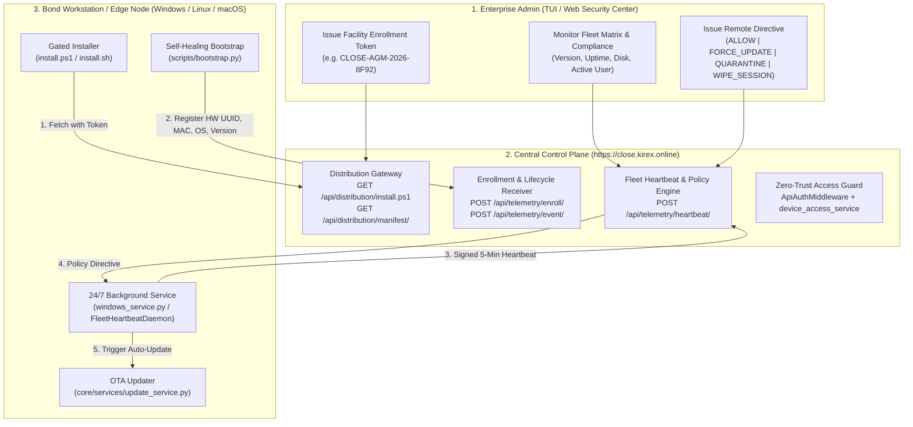

# CLOSE Copilot — Enterprise Distribution, Installation & Access Monitoring Roadmap (Level 12 / v1.2.0)

> **Architectural Vision ("Microsoft Closed Copilot Model")**  
> Transform **CLOSE Copilot** from an open GitHub-script distribution model into a **centrally governed, zero-trust enterprise fleet** where every installer download, edge laptop bootstrap, version upgrade, operator login, and mobile companion pairing is cryptographically enrolled, audited in real time on `https://close.kirex.online`, and remotely controllable.

> **Status (v1.3.0): implemented.** It is built on the existing installs and signed check-in:
>
> | Roadmap name | Implemented as |
> | :--- | :--- |
> | `InstalledNode` | `governance.InstallRegistration`: machine fingerprint, sealed secret, clone detection, bond, health, services |
> | `EnrollmentToken` | `governance.EnrollmentToken`: hashed, seats, expiry, bond, CIDR |
> | `InstallationLifecycleEvent` | `governance.InstallLifecycleEvent` (append-only) |
> | `SecurityAccessAuditLog` | `governance.SecurityEvent` (append-only), plus `governance.LoginAttempt` for sign-ins |
> | `/api/distribution/install.ps1?token=` | `/backoffice/api/v1/installs/script/<token>/install.ps1` (and `install.sh`) |
> | `/api/distribution/manifest/` | `/backoffice/api/v1/installs/manifest/` |
> | `/api/telemetry/enroll/`, `/heartbeat/` | `/backoffice/api/v1/installs/enroll/`, `/heartbeat/` (HMAC-signed both ways, every 60 s) |
> | `FleetHeartbeatDaemon` | `PolicySyncDaemon` |
> | Remote directives | Signed commands: `update.apply`, `update.rollback`, `itms.wipe_session`, lock / unlock, sync, vision, outbox |
> | `api_security_overview` extension | Backoffice → Installs, Services and Sign-ins (the admin works only in the backoffice) |
> | `itms fleet …` | `itms fleet status \| token \| directive` |
>
> See `docs/RELEASE_NOTES_v1.3.0.md`.

---

## 1. End-to-End Enterprise Control Plane Architecture

---

## 2. Gap Analysis: Current (`v1.1.0`) vs. Target (`v1.2.0`)

| Lifecycle Stage | Current State (`v1.1.0`) | Target Enterprise State (`v1.2.0` — Microsoft Model) |
| :--- | :--- | :--- |
| **Distribution** | Public raw GitHub URLs in `install.ps1` and `install.sh`; zero download telemetry or token gating. | Token-gated installer endpoints on `close.kirex.online` with seat limits, expiry, facility binding, and SHA-256 signed release manifests. |
| **Installation** | `scripts/bootstrap.py` runs silently offline and seeds `admin / admin` locally on SQLite. | Hardware-fingerprinted node enrollment (`InstalledNode`), mandatory enrollment token or central operator activation, and real-time step-by-step install telemetry (`INSTALL_STARTED` -> `BOOTSTRAP_COMPLETED`). |
| **Access Control** | `AuthorizedDevice` + `EmailAccessRequest` guard HTTP routes, but lack an immutable security event ledger and anomaly auto-quarantine. | Append-only `SecurityAccessAuditLog` tracking every login, 2FA attempt, QR pairing, IP jump, and MAC mismatch with automated quarantine rules. |
| **Fleet Monitoring** | No visibility into which edge laptops are online, which version they run, or if an uninstall occurred. | 5-minute signed heartbeat daemon in `windows_service.py` reporting version, disk, OCR status, and executing remote `FORCE_UPDATE`, `QUARANTINE`, or `WIPE_SESSION` directives. |

---

## 3. Phased Implementation Roadmap

### Phase 1: Database Schema & Multi-DB Telemetry Foundations (`Days 1–2`)
All migrations maintain 100% backward compatibility across both **SQLite** (local edge stations) and **PostgreSQL** (central server), using safe defaults and zero destructive operations.

* **Target File**: `core/models.py`
* **Deliverables**:
  1. **`EnrollmentToken` Model**:
     * Fields: `token_code` (unique, indexed, e.g. `CLOSE-AGM-2026-XXXX`), `label`, `facility_code` (`AGM`, `SPIRO`, etc.), `issued_by` (`ForeignKey(User)`), `max_seats` (default `5`), `used_seats` (default `0`), `allowed_ip_cidr` (optional), `expires_at`, `is_revoked`, `created_at`.
     * Purpose: Controls who is allowed to download and run `install.ps1` / `install.sh` and binds new installations to a specific bonded warehouse facility.
  2. **`InstalledNode` Model ("Microsoft Intune Device Record")**:
     * Identity: `node_uuid` (unique deterministic hash of OS MachineGuid/SMBIOS UUID + primary physical NIC MAC), `node_secret_hash` (HMAC secret issued upon enrollment), `hostname`, `facility_code`, `enrolled_token` (`ForeignKey(EnrollmentToken)`).
     * Environment: `os_platform` (`Windows`, `Linux`, `Darwin`), `os_version`, `cpu_arch`, `python_version`, `app_version` (e.g. `1.1.0`), `git_commit`, `db_vendor` (`sqlite` / `postgresql`), `ocr_engine` (`PaddleOCR` / `Tesseract`), `yolo_weights`.
     * Network & Operator: `public_ip`, `lan_ip`, `mac_address`, `last_active_operator`, `service_installed` (`bool`).
     * Health & Governance: `status` (`ENROLLED`, `ONLINE`, `OFFLINE`, `OUTDATED`, `QUARANTINED`, `REVOKED`, `UNINSTALLED`), `remote_directive` (`NONE`, `FORCE_UPDATE`, `ROLLBACK_PREVIOUS`, `QUARANTINE_LOCK`, `WIPE_ITMS_SESSION`), `directive_payload` (`JSONField`), `vault_free_gb` (`FloatField`), `first_installed_at`, `last_updated_at`, `last_heartbeat_at`.
  3. **`InstallationLifecycleEvent` Model (Append-Only Distribution & Install Ledger)**:
     * Fields: `node` (`ForeignKey(InstalledNode, null=True)`), `event_type` (`SCRIPT_DOWNLOADED`, `INSTALL_STARTED`, `INSTALL_COMPLETED`, `INSTALL_FAILED`, `UPDATE_CHECKED`, `UPDATE_APPLIED`, `UPDATE_FAILED`, `ROLLBACK_APPLIED`, `SERVICE_STARTED`, `SERVICE_STOPPED`, `UNINSTALL_COMPLETED`), `from_version`, `to_version`, `client_ip`, `mac_address`, `os_info`, `status` (`SUCCESS` / `FAILURE`), `error_detail`, `metadata_json`, `created_at`.
  4. **`SecurityAccessAuditLog` Model (Append-Only Entra-Style Access Ledger)**:
     * Fields: `event_type` (`LOGIN_SUCCESS`, `LOGIN_FAILED`, `SIGNUP_2FA_SENT`, `SIGNUP_2FA_VERIFIED`, `DEVICE_APPROVED`, `DEVICE_BLOCKED`, `DEVICE_EXPIRED`, `QR_PAIRED`, `ANOMALY_IP_JUMP`, `ANOMALY_MAC_MISMATCH`), `user` (`ForeignKey(User, null=True)`), `username_or_email`, `device_id`, `client_ip`, `mac_address`, `user_agent`, `facility_code`, `trace_id`, `reason`, `created_at`.

---

### Phase 2: Gated Distribution Gateway & Signed Release Manifests (`Days 3–4`)
* **Target Files**:
  * New service: `core/services/distribution_service.py`
  * Views & Routes: `core/views/system.py`, `core/urls.py`
  * Installer scripts: `install.ps1`, `install.sh`
* **Deliverables**:
  1. **Token-Gated Installer Endpoints**:
     * `GET /api/distribution/install.ps1?token=<TOKEN_CODE>`
     * `GET /api/distribution/install.sh?token=<TOKEN_CODE>`
     * Validates `EnrollmentToken` (not expired, not revoked, `used_seats < max_seats`, optional CIDR match).
     * Logs `SCRIPT_DOWNLOADED` in `InstallationLifecycleEvent` with client IP and User-Agent.
     * Dynamically injects `$EnrollmentToken = "<TOKEN_CODE>"` and `$ControlPlaneUrl = "https://close.kirex.online"` into the served script so the edge installer automatically authenticates during bootstrap.
  2. **Signed Release Manifest Endpoint**:
     * `GET /api/distribution/manifest/` returns the latest approved semantic version, GitHub/CDN download URL, expected SHA-256 archive checksum, and minimum required version policy (`min_allowed_version`).
  3. **Cryptographic Checksum Verification in `UpdateService`**:
     * Enhance `core/services/update_service.py` to verify the SHA-256 digest of downloaded release ZIPs before extracting, preventing corrupted or tampered update packages.

---

### Phase 3: Self-Healing Bootstrap Enrollment & Removal of Hardcoded `admin / admin` (`Days 5–6`)
* **Target Files**:
  * `scripts/bootstrap.py`
  * `uninstall.ps1`, `uninstall.sh`, `itms_cli.py`
* **Deliverables**:
  1. **Deterministic Hardware Node Fingerprinting**:
     * Create `core/services/telemetry_service.py` with `get_hardware_node_uuid()` (reads Windows `HKLM\SOFTWARE\Microsoft\Cryptography\MachineGuid` or Linux `/etc/machine-id` + primary physical MAC address).
  2. **Bootstrap Enrollment Handshake (`POST /api/telemetry/enroll/`)**:
     * During `scripts/bootstrap.py`:
       * Sends `INSTALL_STARTED` at step 1 and `INSTALL_COMPLETED` (or `INSTALL_FAILED` with traceback) at completion.
       * Exchanges `ITMS_ENROLL_TOKEN` for a persistent per-node HMAC key stored in `secure/node_identity.json`.
       * Automatically configures the edge workstation's `ACTIVE_BOND_CODE` from the token's `facility_code`.
  3. **Eliminate Unconditional `admin / admin` Superuser Bypass**:
     * Only seed `admin / admin` when explicitly running in local developer/test mode (`DEVELOPER_MODE=True`).
     * On production/edge workstations, sync pre-approved operator accounts from the enrollment response or require initial login via the `/access/activate/` 6-digit activation code flow.
  4. **Uninstall & Update Telemetry Hooks**:
     * Hook `itms update`, `itms rollback`, and `itms uninstall` in `itms_cli.py` to dispatch `UPDATE_APPLIED`, `ROLLBACK_APPLIED`, and `UNINSTALL_COMPLETED` events to `close.kirex.online` (with a 3-second non-blocking timeout so offline workstations never hang).

---

### Phase 4: 24/7 Fleet Heartbeat Daemon & Remote Directive Execution (`Days 7–8`)
* **Target Files**:
  * New daemon: `core/services/fleet_heartbeat_daemon.py`
  * Service wrappers: `windows_service.py`, `core/management/commands/run_web.py`
  * Middleware: `core/middleware/api_auth_middleware.py`
* **Deliverables**:
  1. **`FleetHeartbeatDaemon` (5-Minute Background Pulse)**:
     * Runs alongside `ShiftOrderSyncDaemon` and `MorningKitSyncDaemon`.
     * Sends HMAC-signed JSON payload to `POST https://close.kirex.online/api/telemetry/heartbeat/`.
     * **Offline Queue Resilience**: If the bond warehouse internet drops, lifecycle events are buffered in `secure/telemetry_outbox.json` and flushed automatically on the next successful heartbeat.
  2. **Remote Directive Executor ("Intune Remote Actions")**:
     * When the central server returns a `remote_directive` in the heartbeat response:
       * `FORCE_UPDATE`: Spawns background `update_service.apply_update()` and restarts `ITMSVerificationService`.
       * `ROLLBACK_PREVIOUS`: Executes `update_service.rollback_version(target_tag)`.
       * `QUARANTINE_LOCK`: Writes signed lock state to `secure/node_quarantine.json`; `ApiAuthMiddleware` immediately blocks local Web/API access with a `NODE_QUARANTINED_BY_ADMIN` screen.
       * `WIPE_ITMS_SESSION`: Purges `OperatorITMSSession` cookies and `secure/auth/itms_tokens.json` remotely.

---

### Phase 5: Entra-Style Access Anomaly Detection & Security Ledger (`Days 9–10`)
* **Target Files**:
  * `core/services/device_access_service.py`
  * `core/views/auth.py`
* **Deliverables**:
  1. **Comprehensive Access Event Hooks**:
     * Record every authentication, 2FA verification, QR pairing, device block/unblock, and expiry in `SecurityAccessAuditLog` with the request's `X-Trace-ID`.
  2. **Automated Anomaly Detection**:
     * **MAC Spoof / Cookie Clone Detection**: If a request presents a valid `itms_device_trust` cookie on the local LAN, but the kernel ARP table resolves a *different* non-empty physical MAC address than the one bound to `AuthorizedDevice`, flag `ANOMALY_MAC_MISMATCH` and auto-transition the device to `PENDING` for admin review.
     * **Brute-Force Activation Lockout**: Auto-block IP/MAC after 5 consecutive failed 6-digit activation or 2FA codes within 15 minutes.

---

### Phase 6: Fleet CLI, TUI Security Center & Frontend API Contracts (`Days 11–12`)
* **Target Files**:
  * `itms_cli.py`
  * `core/views/auth.py` (`api_security_overview`, `api_security_action`)
  * `docs/FRONTEND REQUEST.MD`
* **Deliverables**:
  1. **Universal CLI Fleet Management (`itms fleet`)**:
     * `itms fleet status` — Live table of all enrolled workstations (`Node ID`, `Hostname`, `Facility`, `Version`, `Status`, `Last Seen`, `Operator`).
     * `itms fleet token --facility AGM --seats 5 --hours 24` — Prints the ready-to-copy gated PowerShell and Bash install commands.
     * `itms fleet directive <node_uuid> <FORCE_UPDATE|QUARANTINE_LOCK|WIPE_ITMS_SESSION|CLEAR>` — Queues an immediate remote directive for the target machine.
  2. **Extended Security Overview API (`GET /api/security/overview/` & `POST /api/security/action/`)**:
     * Extend `api_security_overview` to include `installed_nodes`, `enrollment_tokens`, `lifecycle_events`, and `access_audit_logs`.
     * Extend `api_security_action` with `issue_enrollment_token`, `revoke_enrollment_token`, `send_node_directive`, `approve_node`, and `revoke_node`.
  3. **Automated Test Suite (`core/tests/test_fleet_telemetry.py`)**:
     * Unit and integration tests covering token-gated script delivery, seat exhaustion, hardware enrollment, HMAC heartbeat verification, remote directive execution, and MAC mismatch anomaly detection.
